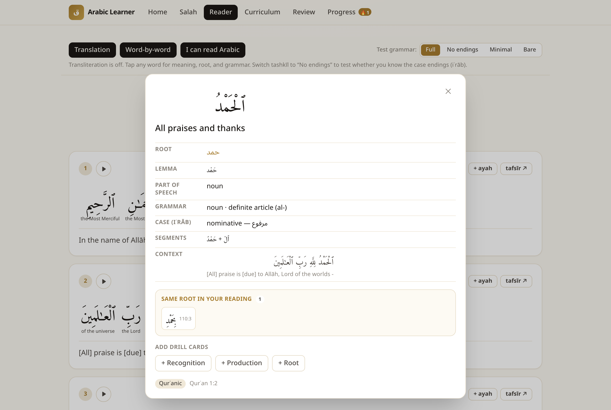

# Arabic Learner

A Next.js web app for learning Arabic grammar from the text of the daily prayer and
the short surahs (Al-Fātiḥah and surahs 105–114). You read the Arabic, tap a word to
see its root, lemma, part of speech, verb form, case, and clitic segments, save words
as flashcards, and review them with FSRS spaced repetition. Cards can be exported to
Anki.

It runs locally. Review state is stored in the browser's `localStorage`; there is no
account or backend.



## Features

- **Salah** (`/salah`): the phrases said in prayer (takbīr, istiftāḥ, rukūʿ, sujūd,
  tashahhud, ṣalawāt, taslīm), word by word with roots.
- **Reader** (`/read/[surah]`): toggleable translation and word-by-word layers, a
  tashkīl control (full / no case endings / minimal / bare) for testing whether you know
  the endings, per-ayah recitation audio, and a link out to tafsīr on Quran.com.
- **Tap panel**: vocalized form, root, lemma, part of speech, derived form (I–X),
  grammatical features, case, clitic segments, the ayah in context, and every other
  word in the loaded surahs that shares the root.
- **Iʿrāb exercises**: on 1:2, 1:5, and 112:1, the grammatical role of each word plus
  short questions about why a word takes its case.
- **Curriculum** (`/curriculum`): six short grammar lessons (word types, the definite
  article, iḍāfah, jār-majrūr, roots and patterns, case endings), each tied to examples
  from the surahs, with quizzes.
- **Review** (`/review`): one FSRS deck. A saved word can produce up to three cards:
  recognition (Arabic to meaning), production (meaning to Arabic), and root.
- **Progress** (`/progress`): streak, words and roots seen, and a 14-day review chart.

## Running it

Requires Node 18.18 or newer (the Next.js 15 minimum).

```bash
npm install
npm run data      # fetch and build the Quran data (see below); needs network
npm run dev       # http://localhost:3000
```

`npm run build && npm start` produces and serves a production build. The build fails
with "Module not found: Can't resolve ./data/quran/index.json" if you skip `npm run data`.

## Data pipeline

The Quran data is **not committed**. Quran.com's API terms allow display but not
redistribution of the raw data, and the Quranic Arabic Corpus morphology is
distributed under a GPL-style data license that requires verbatim copies and
attribution. So the repo ships the scripts that build the data, not the data itself.
`npm run data` runs two steps:

1. **`npm run fetch-data`** (`scripts/fetch-data.mjs`) writes
   `lib/data/quran/<surah>.json` and `index.json`:
   - Downloads `quran-morphology.txt` from
     [mustafa0x/quran-morphology](https://github.com/mustafa0x/quran-morphology)
     (Quranic Arabic Corpus). Each line is one *segment* of a word
     (`sura:aya:word:segment`, form, POS group, features). Segments are grouped by
     `sura:aya:word`. The stem segment supplies root, lemma, part of speech, verb form
     (`VF:n`), and case (`NOM`/`ACC`/`GEN`); prefix segments (conjunctions,
     prepositions, the article) contribute to the segment list and feature tags only.
   - Fetches each surah from the Quran.com API v4 with `words=true`: Uthmani text,
     Saheeh International translation, and per-word translation and transliteration.
   - Joins the two by position. Quran.com returns words plus end-of-ayah markers;
     the script keeps only entries with `char_type_name === "word"`, numbers them from
     1 within each ayah, and looks up `sura:aya:n` in the corpus map. Feature codes
     are mapped to readable labels (e.g. `ACT_PCPL` to "active participle (ism
     fāʿil)").
   - Adds an everyayah.com audio URL per ayah.
2. **`npm run build-roots`** (`scripts/build-roots.mjs`) reads those files offline and
   writes `lib/data/roots.json`, a root-to-occurrences index used by the "same root
   in your reading" section of the tap panel and the progress page.

The scripts are deterministic: running them on a clean checkout produced files
byte-identical to the ones used during development.

The salah phrases, curriculum lessons, and iʿrāb exercises are hand-written and
committed (`lib/data/salah.json`, `curriculum.json`, `irab.json`).

The Quran text is displayed unmodified. The tashkīl levels hide vowel marks at render
time; they never change the stored text.

See [DATA_SOURCES.md](DATA_SOURCES.md) for the licensing notes on every source
considered, and [PLAN.md](PLAN.md) for the original product plan.

## Spaced repetition and Anki

Scheduling uses [`ts-fsrs`](https://github.com/open-spaced-repetition/ts-fsrs) with
default parameters and fuzzing on (`lib/store.tsx`). Each card stores its FSRS state
as JSON in `localStorage`; the review screen shows the next interval for each of the
four grades before you answer.

"Export to Anki" downloads a tab-separated file with Anki's import headers
(`#separator:tab`, `#html:true`, `#columns:...`) and the fields Arabic, Meaning,
Transliteration, Root, Grammar, Context, Source, and Register. It exports card content
only; review history is not carried over, and Anki schedules the cards from scratch.

## Stack

Next.js 15 (App Router, statically generated pages), React 19, TypeScript, Tailwind
CSS, `ts-fsrs`, and Fontsource for Arabic fonts (Amiri Quran, Noto Naskh Arabic, Noto
Sans Arabic). Fontsource is used instead of `next/font/google` because Google's
subsetting can drop diacritics.

## Attribution and licensing

The app footer credits Quran.com (text and Saheeh International translation), the
Quranic Arabic Corpus at [corpus.quran.com](https://corpus.quran.com) (morphology; the
link is required by its license), and everyayah.com (recitation). This project is for
personal study. Check the terms in DATA_SOURCES.md before hosting it publicly; the
recitation audio in particular is streamed from a third party.
